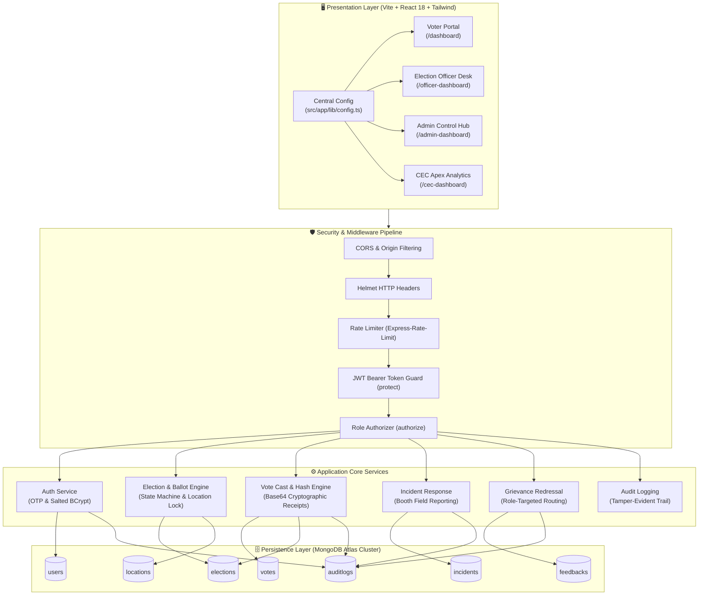

<div align="center">

# 🗳️ Secure Online Voting System (SOVS)
### *A Mission-Critical, Cryptographically Verifiable & Role-Governed Digital Democracy Platform*

[](https://github.com/pawan864/SOVS---Online-Voting-Portal)
[](https://github.com/pawan864/SOVS---Online-Voting-Portal)
[](https://github.com/pawan864/SOVS---Online-Voting-Portal)
[](https://www.mongodb.com/)

<p align="center">
  <a href="#-core-pillars">Core Pillars</a> •
  <a href="#-architecture-blueprint">Architecture</a> •
  <a href="#-governance-roles--credentials">Roles & Access</a> •
  <a href="#-api-directory">API Directory</a> •
  <a href="#-local-development">Getting Started</a> •
  <a href="#-deployment">Deployment</a>
</p>

---

</div>

## 📌 Executive Summary

**SOVS (Secure Online Voting System)** is an enterprise-grade electronic electoral infrastructure built to modernize democratic elections. Engineered with **zero-knowledge privacy principles**, **multi-tier Role-Based Access Control (RBAC)**, and **tamper-evident audit trails**, SOVS eliminates electoral fraud, enforces strict single-ballot constraints, and delivers verifiable election transparency from polling booths to the national apex commission.

---

## 🌟 Core Pillars

<table>
  <tr>
    <td width="50%">
      <h3>🔐 Cryptographic Ballot Secrecy</h3>
      <ul>
        <li><b>One Person, One Vote:</b> Enforced by MongoDB compound unique indexes (<code>userId</code> + <code>electionId</code>).</li>
        <li><b>Zero-Knowledge Separation:</b> Voter identity is cryptographically decoupled from candidate choices.</li>
        <li><b>Digital Audit Receipts:</b> Every ballot produces an immutable Base64 verification hash with timestamp proof.</li>
      </ul>
    </td>
    <td width="50%">
      <h3>📍 Area-Locked Electoral Boundaries</h3>
      <ul>
        <li><b>Multi-Level Geofencing:</b> <code>State → District → Sub-District → Locality</code> hierarchical geofencing.</li>
        <li><b>Dynamic Voter Verification:</b> Restricts voters to ballots strictly registered to their administrative constituency.</li>
        <li><b>Granular Candidate Visibility:</b> Elections are filtered dynamically based on eligibility registries.</li>
      </ul>
    </td>
  </tr>
  <tr>
    <td width="50%">
      <h3>🛡️ Defense-in-Depth Security</h3>
      <ul>
        <li><b>Rate-Limiting & Anti-Brute Force:</b> Tiered request throttlers for sensitive authentication and public endpoints.</li>
        <li><b>HTTP Hardening:</b> Full HTTP header protection using Helmet, CORS origin isolation, and parameterized queries.</li>
        <li><b>Dual-Factor Voter Onboarding:</b> Mock Aadhaar/ECI identity verification with fast OTP authorization.</li>
      </ul>
    </td>
    <td width="50%">
      <h3>📊 Live Governance & Incident Response</h3>
      <ul>
        <li><b>Turnout Analytics:</b> Real-time hourly turnout monitoring and demographic participation distributions.</li>
        <li><b>Booth Glitch Tracking:</b> On-ground Election Officers log and resolve EVM, power, or polling station incidents.</li>
        <li><b>Voter Redressal Inbox:</b> Direct citizen grievance routing with official response tracking.</li>
      </ul>
    </td>
  </tr>
</table>

---

## 🏛️ Governance Roles & Credentials

The system defines **4 distinct constitutional roles** designed around separation of concerns:

```
                               ┌─────────────────────────────────┐
                               │   Secure Access Gateway (/login) │
                               └──────────────┬──────────────────┘
                                              │
              ┌───────────────────────────────┼───────────────────────────────┐
              ▼                               ▼                               ▼
    ┌──────────────────┐            ┌──────────────────┐            ┌──────────────────┐
    │   Voter (Citizen) │            │ Election Officer │            │   System Admin   │
    │  • Aadhaar / ECI │            │  • District Ops  │            │  • Election Hub  │
    │  • Cast Ballots  │            │  • Polling Booth │            │  • User Blocking │
    │  • Get Receipt   │            │  • Resolve Issues│            │  • Geo Locations │
    └──────────────────┘            └──────────────────┘            └──────────────────┘
              │                               │                               │
              └───────────────────────────────┼───────────────────────────────┘
                                              ▼
                                ┌───────────────────────────┐
                                │ Chief Election Comm. (CEC)│
                                │ • Apex National Analytics │
                                │ • Electoral Certification │
                                │ • System Integrity Audit  │
                                └───────────────────────────┘
```

| Authority / Role | Identity Type | Official Credentials | Associated Route & Primary Function |
| :--- | :--- | :--- | :--- |
| **Voter**<br/>*(मतदाता)* | Aadhaar / ECI + OTP | **Aadhaar:** `1234-5678-9012`<br/>**ECI Card:** `ECI-VTR-001`<br/>**OTP:** `123456` | `/dashboard` & `/voter-dashboard`<br/>Browse active elections, cast encrypted ballots, download cryptographic receipts, register complaints. |
| **Election Officer**<br/>*(चुनाव अधिकारी)* | Official Government Email | **Email:** `officer@securevote.gov.in`<br/>**Password:** `Officer@1234` | `/officer-dashboard`<br/>Supervise polling stations, monitor live turnout trends, investigate reported EVM/booth incidents. |
| **System Admin**<br/>*(व्यवस्थापक)* | Official Government Email | **Email:** `admin@securevote.gov.in`<br/>**Password:** `Admin@1234` | `/admin-dashboard` & `/admin`<br/>Create elections, manage candidate rosters, configure geographic boundaries, block suspicious voter IDs. |
| **Chief Election Commissioner**<br/>*(मुख्य चुनाव आयुक्त)* | Apex Commission Email | **Email:** `cec@securevote.gov.in`<br/>**Password:** `CEC@1234` | `/cec-dashboard`<br/>National-level participation metrics, commission oversight, electoral certification, apex grievance review. |

---

## 🏗️ Architecture Blueprint



---

## 🔌 API Directory

All API routes are served under `/api` and require JSON payloads.

### 🔑 Authentication & Identity (`/api/auth`)
| Method | Endpoint | Access | Description |
| :--- | :--- | :--- | :--- |
| `POST` | `/api/auth/voter/send-otp` | Public | Generates 15-second OTP for Aadhaar/ECI voter |
| `POST` | `/api/auth/voter/verify-otp` | Public | Verifies OTP and returns voter session token |
| `POST` | `/api/auth/login` | Public | Staff login for Officer, Admin, and CEC |
| `POST` | `/api/auth/reset-password` | Public | Secure password reset for official accounts |
| `GET` | `/api/auth/me` | Authenticated | Retrieves active user profile |

### 🗳️ Elections & Ballots (`/api/elections` & `/api/votes`)
| Method | Endpoint | Access | Description |
| :--- | :--- | :--- | :--- |
| `GET` | `/api/elections` | Optional Auth | List active/upcoming elections filtered by role/area |
| `POST` | `/api/elections` | Admin | Create a new election with geographical scope |
| `POST` | `/api/elections/:id/candidates` | Admin | Add candidate to specified election |
| `GET` | `/api/elections/:id/results` | Public | Tally verified results and turnout percentages |
| `POST` | `/api/votes/cast` | Voter | Cast encrypted ballot (one-vote guarantee) |
| `GET` | `/api/votes/receipt/:id` | Voter | Fetch anonymous cryptographic vote receipt |
| `GET` | `/api/votes/has-voted/:id` | Voter | Check voter participation status |
| `GET` | `/api/votes/recent` | Staff | Stream latest verified ballot hashes |

### 📊 Role Dashboards (`/api/dashboard`)
| Method | Endpoint | Access | Description |
| :--- | :--- | :--- | :--- |
| `GET` | `/api/dashboard/voter` | Voter | Voter-specific election counters and vote history |
| `GET` | `/api/dashboard/officer` | Officer, Admin | District polling station metrics and incident stats |
| `GET` | `/api/dashboard/cec` | CEC, Admin | Apex national metrics, total turnout, and certified tallies |
| `GET` | `/api/dashboard/admin` | Admin | Comprehensive system statistics and security logs |

### ⚠️ Incidents, Locations & Feedback
| Method | Endpoint | Access | Description |
| :--- | :--- | :--- | :--- |
| `GET` | `/api/incidents` | Staff | Fetch field incident reports |
| `POST` | `/api/incidents` | Staff | Report polling booth anomaly or EVM glitch |
| `PUT` | `/api/incidents/:id/resolve` | Staff | Mark incident as resolved with notes |
| `GET` | `/api/locations` | Public | Query State → District → Sub-District hierarchy |
| `POST` | `/api/feedback` | Voter | File feedback or role-directed electoral complaint |
| `PUT` | `/api/feedback/:id/respond` | Staff | Authority replies to and closes voter grievance |

---

## 💻 Local Development

### 1. Clone & Setup Monorepo
```bash
git clone https://github.com/pawan864/SOVS---Online-Voting-Portal.git
cd SOVS---Online-Voting-Portal
```

### 2. Configure Backend
```bash
cd backend
npm install
cp .env.example .env
```
Fill in your `backend/.env`:
```env
PORT=5001
NODE_ENV=development
MONGODB_URI=mongodb+srv://<username>:<password>@cluster.mongodb.net/securevote?retryWrites=true&w=majority
JWT_SECRET=super_secret_jwt_key_here
JWT_EXPIRES_IN=30m
OTP_SECRET=123456
CLIENT_URL=http://localhost:5173
```

Seed initial database collections (creates demo users & realistic elections):
```bash
node seed/seeder.js
```

Start the backend:
```bash
node server.js
# 🚀 SecureVote API running on http://localhost:5001
```

### 3. Configure Frontend
```bash
# In a new terminal
cd ../frontend
npm install
npm run dev
# ➜ Local: http://localhost:5173/
```

*Note: The frontend automatically proxies `/api` calls to `http://localhost:5001` in local mode.*

---

## ☁️ Deployment

### Backend (Render / Railway / DigitalOcean)
- **Root Directory**: `backend`
- **Build Command**: `npm install`
- **Start Command**: `node server.js`
- **Required Environment Variables**:
  `MONGODB_URI`, `JWT_SECRET`, `NODE_ENV=production`, `PORT=5001`.

### Frontend (Vercel / Netlify / Cloudflare Pages)
- **Root Directory**: `frontend`
- **Build Command**: `npm run build`
- **Output Directory**: `dist`
- **Required Environment Variables**:
  `VITE_API_URL=https://<your-backend-domain>.onrender.com/api`
- [vercel.json](file:///c:/Users/Pawan/OneDrive/Desktop/SOVS%20(1)/SOVS/frontend/vercel.json) is pre-configured with SPA route rewrites to `index.html`.

---

## 📄 License & Attribution

This project is licensed under the **MIT License**. Built with integrity for democratic transparency.

<div align="center">
  <sub>Securing Digital Democracy · Election Commission of India Portal Simulation</sub>
</div>
